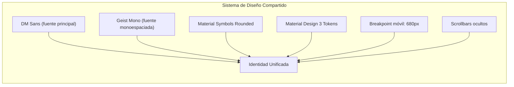
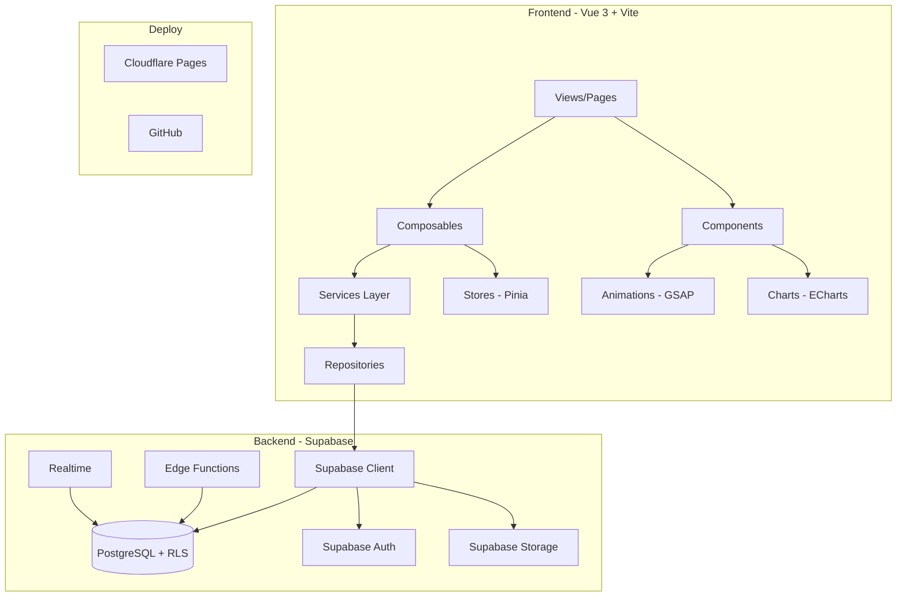
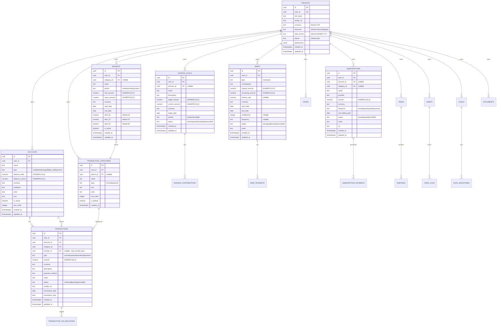
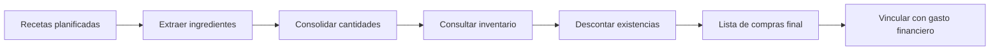
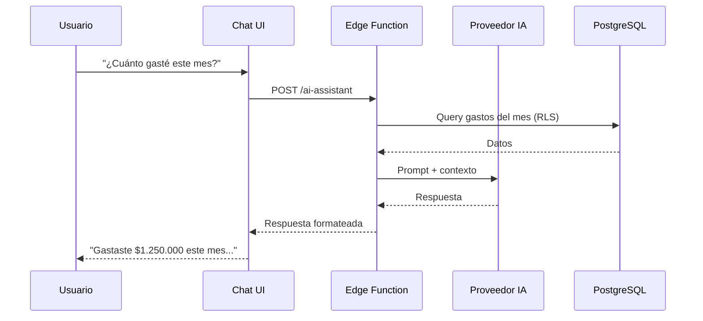
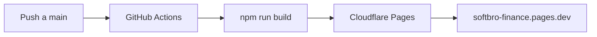
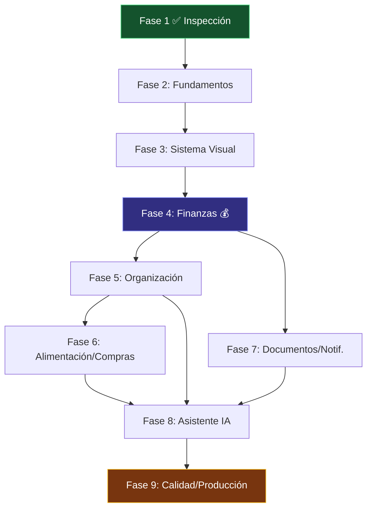

# Plan Maestro de Implementación — softbro Finance (sb Finance)

## Objetivo

Construir **softbro Finance** desde cero: una plataforma web integral de gestión financiera y organización personal. Proyecto en directorio vacío (`/home/srjoan/projects/softbro/softbro-finance`). Stack: Vue 3 + TypeScript + Vite + Pinia + Vue Router + CSS puro + GSAP + ECharts + Supabase + PostgreSQL.

El plan está dividido en **9 fases secuenciales**. Cada fase tiene entregables concretos, archivos a crear, verificaciones y criterios de aceptación. **No se avanza a la siguiente fase si la anterior tiene errores críticos.**

---

## Hallazgos de la Inspección de Referencias

### Acceso confirmado

Ambas referencias fueron inspeccionadas exitosamente (HTTP 200):
- ✅ **Stepbro Tasks** — `https://stepbro.site/apps/tasks/`
- ✅ **Stepbro Money** — `https://stepbro.site/apps/money/`

### Patrones Visuales Compartidos



| Aspecto | Stepbro Tasks | Stepbro Money | sb Finance (Propuesta) |
|---|---|---|---|
| **Tema default** | OLED (fondo negro `#131316`) | Neogreen (verde `#0c160d`) | Tema propio oscuro neutro + claro |
| **Acento primario** | Neutro/blanco | Verde `#006e2c` / `#00e563` | Negro monocromático (como Tasks) |
| **Nav style** | style-5 (bottom/icon) | style-2 (sidebar pill) | style-1 (sidebar completo) |
| **Iconos** | Material Symbols Rounded | Material Symbols Rounded | Lucide (requisito del prompt) |
| **Fuente** | DM Sans | DM Sans | DM Sans (mantener) |
| **Monofuente** | Geist Mono | Geist Mono | Geist Mono (mantener) |

### Tokens de Color Extraídos (MD3)

**Dark mode (referencia Money):**
```css
--background: #0c160d       → Adaptaremos a neutro
--surface-container: #182218 → Neutro
--surface-container-high: #222c22 → Neutro
--on-surface: #dae6d6       → Neutro claro
--outline: #849582           → Gris neutro
--primary: #ffffff
--error: #ffb4ab
--error-container: #93000a
--success: #00FF00
--alert: #FF9900
```

### Patrones de Navegación (CSS real extraído)

**Sidebar style-1** (el más completo, elegido para sb Finance):
- `min-width: 270px`, `padding: 16px`
- Botones: `height: 40px`, `padding: 8px 16px`, `border-radius: 12px`, `font-size: 16px`, `font-weight: 500`
- Activo: `background: surface-container-high`, `color: primary`, icono FILL 1
- Hover: `color: primary`
- Separador con pseudo-elemento `:after`
- Sección inferior con `margin-top: auto`

### Sistema de Espaciado

Escala consistente extraída: `0, 2px, 4px, 6px, 8px, 12px, 16px, 24px, 32px, 40px, 48px, 56px, 64px`

### Sistema de Border-Radius

`0, 12px, 16px, 18px, 20px, 24px, 28px, 32px, 40px, 48px, 64px`

- Cards principales: `16px-24px`
- Modales: `16px-32px`
- Chips/pills: `40px-64px`
- Inputs: `16px`

### Tipografía (Font Sizes)

`10px, 11px, 12px, 13px, 14px, 15px, 16px, 18px, 20px, 22px, 24px, 28px, 32px, 36px, 45px, 57px`

- Body: `14px`
- Labels: `11-12px`
- Titles: `16-22px`
- Display (money total): `46-57px`
- Navegación: `16px weight 500`

### Componentes Financieros Clave (Money)

- **Amount chips**: `padding: 4px 8px`, `border-radius: 16px`, colores por tono (positivo=primary, negativo=error)
- **Balance bubble**: `padding: 8px 12px`, `border-radius: 24px`, fondo semitransparente
- **Money total**: `font-size: 57px` (desktop) / `46px` (móvil)
- **Status chips**: variantes por tono (success, alert, error, primary, tertiary, light)

### Animaciones

- Transición de iconos: `125ms cubic-bezier(.48,0,0,1)`
- Transiciones generales: `225ms` / `300ms`
- `font-variation-settings` animado para relleno de iconos
- Breakpoint móvil: `680px`

---

## Decisiones de Diseño Importantes

> [!IMPORTANT]
> ### 1. Iconografía: Lucide vs Material Symbols
> Las referencias usan **Material Symbols Rounded**, pero el prompt exige **Lucide**. Se usará **Lucide** como se requiere. Los iconos de Material Symbols tienen variación de relleno (FILL 0→1), lo cual no existe en Lucide. Se simulará el estado activo con color + opacidad en lugar de relleno.

> [!IMPORTANT]
> ### 2. Material Web Components
> Las referencias usan `md-icon`, `md-ripple`, `md-elevation` (Lit/Web Components de Material). **sb Finance NO las usará** (el prompt prohíbe frameworks de diseño). Se implementarán componentes propios en Vue que repliquen los patrones visuales.

> [!IMPORTANT]
> ### 3. Paleta de Color: Negro Monocromático
> Se usará un esquema **negro monocromático** idéntico al enfoque de Stepbro Tasks: en dark mode el primary es blanco (`#ffffff`), en light mode es negro (`#000000`). Esto produce una estética ultra-limpia y profesional. Los acentos de color provienen exclusivamente de colores semánticos (verde=éxito/ingreso, rojo=error/gasto, amarillo=alerta).

> [!IMPORTANT]
> ### 4. Supabase: Proyecto Real Necesario
> Para las fases 2+ se necesitará un proyecto de Supabase real (URL + anon key). La Fase 1 y 2 se diseñan con interfaces y tipos listos, pero con mock services que se reemplazarán por Supabase real.

---

## Open Questions

> [!IMPORTANT]
> ### Q1: Credenciales de Supabase
> ¿Ya tienes un proyecto de Supabase creado para sb Finance? Necesitaré:
> - `VITE_SUPABASE_URL`
> - `VITE_SUPABASE_ANON_KEY`
> 
> Si no lo tienes, puedo diseñar todo con servicios mock y la capa de abstracción lista, para conectar Supabase cuando lo tengas.

> [!IMPORTANT]
> ### Q2: Color de Acento
> ¿Prefieres un tono azul-índigo como acento primario (confianza financiera) o algún otro color específico? Las referencias usan verde para Money y neutro para Tasks.

> [!IMPORTANT]
> ### Q3: Dominio y Despliegue
> ¿Ya tienes configurado Cloudflare Pages o el repositorio GitHub para este proyecto? Se necesitará para la Fase 9.

---

## Arquitectura General



### Estructura del Proyecto

```
softbro-finance/
├── .env.example
├── .env.local                    # No committed
├── .gitignore
├── index.html
├── package.json
├── tsconfig.json
├── tsconfig.node.json
├── vite.config.ts
├── vitest.config.ts
├── playwright.config.ts
├── eslint.config.js
├── public/
│   ├── favicon.svg
│   └── manifest.json
├── src/
│   ├── main.ts
│   ├── App.vue
│   ├── assets/
│   │   └── fonts/
│   ├── styles/
│   │   ├── main.css              # Entry point
│   │   ├── reset.css             # CSS reset
│   │   ├── tokens.css            # Design tokens (colores, espacios, radios...)
│   │   ├── themes/
│   │   │   ├── light.css
│   │   │   └── dark.css
│   │   ├── typography.css
│   │   ├── layout.css
│   │   ├── utilities.css
│   │   └── transitions.css
│   ├── animations/
│   │   ├── index.ts
│   │   ├── page-transitions.ts
│   │   ├── modal.ts
│   │   ├── panel.ts
│   │   ├── list.ts
│   │   └── micro.ts
│   ├── components/
│   │   ├── common/
│   │   │   ├── SbButton.vue
│   │   │   ├── SbCard.vue
│   │   │   ├── SbChip.vue
│   │   │   ├── SbIcon.vue
│   │   │   ├── SbInput.vue
│   │   │   ├── SbSelect.vue
│   │   │   ├── SbTextarea.vue
│   │   │   ├── SbModal.vue
│   │   │   ├── SbTable.vue
│   │   │   ├── SbPagination.vue
│   │   │   ├── SbEmptyState.vue
│   │   │   ├── SbLoadingState.vue
│   │   │   ├── SbErrorState.vue
│   │   │   ├── SbConfirmDialog.vue
│   │   │   ├── SbToast.vue
│   │   │   ├── SbDropdown.vue
│   │   │   ├── SbDatePicker.vue
│   │   │   ├── SbSwitch.vue
│   │   │   ├── SbProgress.vue
│   │   │   ├── SbAvatar.vue
│   │   │   ├── SbBadge.vue
│   │   │   ├── SbTabs.vue
│   │   │   ├── SbAmount.vue        # Componente monetario
│   │   │   └── SbSearchInput.vue
│   │   ├── navigation/
│   │   │   ├── AppSidebar.vue
│   │   │   ├── AppHeader.vue
│   │   │   ├── AppMobileNav.vue
│   │   │   ├── NavButton.vue
│   │   │   ├── GlobalSearch.vue
│   │   │   ├── NotificationCenter.vue
│   │   │   ├── UserMenu.vue
│   │   │   └── ThemeToggle.vue
│   │   ├── dashboard/
│   │   │   ├── DashboardGrid.vue
│   │   │   ├── FinanceSummaryWidget.vue
│   │   │   ├── TasksWidget.vue
│   │   │   ├── HabitsWidget.vue
│   │   │   ├── GoalsWidget.vue
│   │   │   ├── MealWidget.vue
│   │   │   ├── TrainingWidget.vue
│   │   │   ├── ActivityTimeline.vue
│   │   │   └── WidgetWrapper.vue
│   │   ├── finance/
│   │   │   ├── AccountCard.vue
│   │   │   ├── AccountList.vue
│   │   │   ├── AccountForm.vue
│   │   │   ├── TransactionRow.vue
│   │   │   ├── TransactionList.vue
│   │   │   ├── TransactionForm.vue
│   │   │   ├── TransactionFilters.vue
│   │   │   ├── TransferForm.vue
│   │   │   ├── CategoryTag.vue
│   │   │   ├── CategoryManager.vue
│   │   │   ├── BudgetCard.vue
│   │   │   ├── BudgetProgress.vue
│   │   │   ├── BudgetForm.vue
│   │   │   ├── SavingsGoalCard.vue
│   │   │   ├── SavingsForm.vue
│   │   │   ├── DebtCard.vue
│   │   │   ├── DebtForm.vue
│   │   │   ├── CardWidget.vue
│   │   │   ├── CardForm.vue
│   │   │   ├── RecurringIncomeRow.vue
│   │   │   ├── FinanceChart.vue
│   │   │   ├── FinanceSummary.vue
│   │   │   └── PeriodSelector.vue
│   │   ├── food/
│   │   ├── shopping/
│   │   ├── organization/
│   │   ├── habits/
│   │   ├── training/
│   │   ├── goals/
│   │   ├── subscriptions/
│   │   ├── documents/
│   │   ├── assistant/
│   │   └── settings/
│   ├── layouts/
│   │   ├── AppLayout.vue          # Layout con sidebar
│   │   └── AuthLayout.vue         # Layout de autenticación
│   ├── views/
│   │   ├── auth/
│   │   │   ├── LoginView.vue
│   │   │   ├── RegisterView.vue
│   │   │   └── ForgotPasswordView.vue
│   │   ├── dashboard/
│   │   │   └── DashboardView.vue
│   │   ├── finance/
│   │   │   ├── FinanceOverview.vue
│   │   │   ├── AccountsView.vue
│   │   │   ├── TransactionsView.vue
│   │   │   ├── TransfersView.vue
│   │   │   ├── BudgetsView.vue
│   │   │   ├── SavingsView.vue
│   │   │   ├── DebtsView.vue
│   │   │   ├── CardsView.vue
│   │   │   ├── RecurringIncomeView.vue
│   │   │   └── ReportsView.vue
│   │   ├── food/
│   │   ├── shopping/
│   │   ├── organization/
│   │   ├── habits/
│   │   ├── training/
│   │   ├── goals/
│   │   ├── subscriptions/
│   │   ├── documents/
│   │   ├── assistant/
│   │   └── settings/
│   │       └── SettingsView.vue
│   ├── router/
│   │   ├── index.ts
│   │   ├── guards.ts
│   │   └── routes/
│   │       ├── auth.ts
│   │       ├── dashboard.ts
│   │       ├── finance.ts
│   │       ├── food.ts
│   │       ├── shopping.ts
│   │       ├── organization.ts
│   │       ├── habits.ts
│   │       ├── training.ts
│   │       ├── goals.ts
│   │       ├── subscriptions.ts
│   │       ├── documents.ts
│   │       ├── assistant.ts
│   │       └── settings.ts
│   ├── stores/
│   │   ├── auth.ts
│   │   ├── theme.ts
│   │   ├── ui.ts
│   │   ├── notifications.ts
│   │   ├── accounts.ts
│   │   ├── transactions.ts
│   │   ├── categories.ts
│   │   ├── budgets.ts
│   │   ├── savings.ts
│   │   ├── debts.ts
│   │   ├── cards.ts
│   │   ├── subscriptions.ts
│   │   ├── tasks.ts
│   │   ├── habits.ts
│   │   ├── goals.ts
│   │   └── ...
│   ├── composables/
│   │   ├── useAuth.ts
│   │   ├── useTheme.ts
│   │   ├── useModal.ts
│   │   ├── useToast.ts
│   │   ├── useConfirm.ts
│   │   ├── usePagination.ts
│   │   ├── useFilters.ts
│   │   ├── useForm.ts
│   │   ├── useAmount.ts           # Formateo COP
│   │   ├── useDate.ts             # Formateo DD/MM/AAAA
│   │   ├── useGsap.ts             # Wrapper GSAP + cleanup
│   │   ├── useChart.ts            # Wrapper ECharts
│   │   ├── useSearch.ts
│   │   ├── useKeyboard.ts
│   │   ├── useBreakpoint.ts
│   │   └── useReducedMotion.ts
│   ├── services/
│   │   ├── supabase.ts            # Cliente Supabase
│   │   ├── auth.service.ts
│   │   ├── storage.service.ts
│   │   └── ai.service.ts
│   ├── repositories/
│   │   ├── base.repository.ts
│   │   ├── accounts.repository.ts
│   │   ├── transactions.repository.ts
│   │   ├── categories.repository.ts
│   │   ├── budgets.repository.ts
│   │   ├── savings.repository.ts
│   │   ├── debts.repository.ts
│   │   ├── cards.repository.ts
│   │   ├── subscriptions.repository.ts
│   │   ├── tasks.repository.ts
│   │   ├── habits.repository.ts
│   │   ├── goals.repository.ts
│   │   └── ...
│   ├── types/
│   │   ├── index.ts
│   │   ├── auth.types.ts
│   │   ├── finance.types.ts
│   │   ├── organization.types.ts
│   │   ├── food.types.ts
│   │   ├── shopping.types.ts
│   │   ├── habits.types.ts
│   │   ├── training.types.ts
│   │   ├── goals.types.ts
│   │   ├── subscriptions.types.ts
│   │   ├── documents.types.ts
│   │   ├── assistant.types.ts
│   │   ├── notifications.types.ts
│   │   └── common.types.ts
│   └── utils/
│       ├── currency.ts
│       ├── date.ts
│       ├── validators.ts
│       ├── formatters.ts
│       └── constants.ts
├── supabase/
│   ├── config.toml
│   ├── migrations/
│   │   ├── 00001_profiles.sql
│   │   ├── 00002_accounts.sql
│   │   ├── 00003_categories.sql
│   │   ├── 00004_transactions.sql
│   │   ├── 00005_budgets.sql
│   │   ├── 00006_savings.sql
│   │   ├── 00007_debts.sql
│   │   ├── 00008_cards.sql
│   │   ├── 00009_subscriptions.sql
│   │   ├── 00010_tasks.sql
│   │   ├── 00011_habits.sql
│   │   ├── 00012_goals.sql
│   │   ├── 00013_food.sql
│   │   ├── 00014_shopping.sql
│   │   ├── 00015_training.sql
│   │   ├── 00016_documents.sql
│   │   ├── 00017_notifications.sql
│   │   ├── 00018_assistant.sql
│   │   └── 00019_audit.sql
│   ├── functions/
│   │   └── ai-assistant/
│   └── seed.sql
└── tests/
    ├── unit/
    ├── integration/
    └── e2e/
```

---

## Modelo de Datos Relacional



> [!NOTE]
> El diagrama muestra las entidades principales de la Fase 4 (Finanzas). Las entidades de organización, alimentación, entrenamiento, documentos y asistente se detallan en sus fases respectivas. Todas las tablas incluyen `user_id` para RLS y `created_at`/`updated_at` con timestamps.

---

## FASE 1 — Inspección y Arquitectura (✅ Completada en esta investigación)

**Estado: Documentada arriba.** Los patrones visuales, tokens de diseño, estructura de navegación, tipografía, espaciado, radios de borde y componentes de ambas referencias han sido analizados en detalle a partir de su CSS y HTML reales.

**Entregables:**
- ✅ Inspección de Stepbro Tasks (HTML, CSS, rutas, componentes)
- ✅ Inspección de Stepbro Money (HTML, CSS, tokens MD3, componentes financieros)
- ✅ Documentación de patrones visuales compartidos
- ✅ Definición de arquitectura del proyecto
- ✅ Diseño del modelo de datos relacional
- ✅ Plan de desarrollo por fases

---

## FASE 2 — Fundamentos Técnicos

### Objetivo
Crear el proyecto Vue 3, configurar todas las herramientas del stack y establecer la estructura modular base.

### 2.1 Inicialización del Proyecto

#### [NEW] package.json
```json
{
  "name": "sb-finance",
  "version": "0.1.0",
  "private": true,
  "type": "module",
  "scripts": {
    "dev": "vite",
    "build": "vue-tsc --noEmit && vite build",
    "preview": "vite preview",
    "test:unit": "vitest run",
    "test:unit:watch": "vitest",
    "test:e2e": "playwright test",
    "lint": "eslint src/",
    "type-check": "vue-tsc --noEmit"
  }
}
```

**Dependencias principales:**
```
vue@^3.5          vue-router@^4       pinia@^2
typescript@^5.6   vite@^6             @vitejs/plugin-vue
gsap@^3.12        echarts@^5          vue-echarts@^7
lucide-vue-next   @supabase/supabase-js@^2
```

**Dependencias de desarrollo:**
```
vitest             @vue/test-utils     playwright
@vue/tsconfig      vue-tsc             eslint
@typescript-eslint/eslint-plugin
```

#### [NEW] vite.config.ts
```typescript
import { defineConfig } from 'vite'
import vue from '@vitejs/plugin-vue'
import { resolve } from 'path'

export default defineConfig({
  plugins: [vue()],
  resolve: {
    alias: {
      '@': resolve(__dirname, 'src'),
    },
  },
  css: {
    devSourcemap: true,
  },
  build: {
    target: 'es2022',
    rollupOptions: {
      output: {
        manualChunks: {
          'vue-vendor': ['vue', 'vue-router', 'pinia'],
          'charts': ['echarts', 'vue-echarts'],
          'gsap': ['gsap'],
        },
      },
    },
  },
})
```

#### [NEW] tsconfig.json
```json
{
  "compilerOptions": {
    "target": "ES2022",
    "module": "ESNext",
    "moduleResolution": "bundler",
    "strict": true,
    "jsx": "preserve",
    "importHelpers": true,
    "allowJs": false,
    "sourceMap": true,
    "baseUrl": ".",
    "paths": { "@/*": ["src/*"] },
    "lib": ["ES2022", "DOM", "DOM.Iterable"],
    "types": ["vite/client"],
    "noUnusedLocals": true,
    "noUnusedParameters": true,
    "noFallthroughCasesInSwitch": true,
    "forceConsistentCasingInFileNames": true
  },
  "include": ["src/**/*.ts", "src/**/*.vue", "src/**/*.d.ts"],
  "exclude": ["node_modules", "dist"]
}
```

### 2.2 Sistema de Diseño CSS

#### [NEW] src/styles/tokens.css
```css
:root {
  /* === SPACING === */
  --space-0: 0px;
  --space-1: 2px;
  --space-2: 4px;
  --space-3: 6px;
  --space-4: 8px;
  --space-5: 12px;
  --space-6: 16px;
  --space-7: 24px;
  --space-8: 32px;
  --space-9: 40px;
  --space-10: 48px;
  --space-11: 56px;
  --space-12: 64px;

  /* === RADIUS === */
  --radius-none: 0px;
  --radius-sm: 8px;
  --radius-md: 12px;
  --radius-lg: 16px;
  --radius-xl: 24px;
  --radius-2xl: 32px;
  --radius-pill: 40px;
  --radius-full: 9999px;

  /* === TYPOGRAPHY === */
  --font-family: 'DM Sans', system-ui, -apple-system, sans-serif;
  --font-mono: 'Geist Mono', 'SF Mono', monospace;

  --text-xs: 11px;
  --text-sm: 12px;
  --text-base: 14px;
  --text-md: 16px;
  --text-lg: 18px;
  --text-xl: 20px;
  --text-2xl: 24px;
  --text-3xl: 28px;
  --text-4xl: 32px;
  --text-5xl: 36px;
  --text-display: 46px;
  --text-display-lg: 57px;

  --weight-regular: 400;
  --weight-medium: 500;
  --weight-semibold: 600;
  --weight-bold: 700;

  /* === TRANSITIONS === */
  --duration-fast: 125ms;
  --duration-normal: 225ms;
  --duration-slow: 300ms;
  --duration-slower: 500ms;
  --ease-standard: cubic-bezier(0.2, 0, 0, 1);
  --ease-decelerate: cubic-bezier(0, 0, 0, 1);
  --ease-accelerate: cubic-bezier(0.3, 0, 1, 1);
  --ease-spring: cubic-bezier(0.38, 0.49, 0, 1.5);

  /* === SIDEBAR === */
  --sidebar-width: 270px;
  --sidebar-collapsed-width: 72px;
  --header-height: 56px;

  /* === BREAKPOINTS (for reference, used in media queries) === */
  /* --bp-mobile: 680px */
  /* --bp-tablet: 1024px */
  /* --bp-desktop: 1280px */

  /* === Z-INDEX === */
  --z-sidebar: 100;
  --z-header: 90;
  --z-dropdown: 200;
  --z-modal-backdrop: 300;
  --z-modal: 310;
  --z-toast: 400;
  --z-tooltip: 500;
}
```

#### [NEW] src/styles/themes/dark.css
```css
[data-theme="dark"] {
  color-scheme: dark;

  /* Surfaces — OLED-inspired pure blacks */
  --color-background: #000000;
  --color-surface: #000000;
  --color-surface-dim: #0a0a0a;
  --color-surface-bright: #121214;
  --color-surface-container-lowest: #0a0a0a;
  --color-surface-container-low: #101012;
  --color-surface-container: #17171a;
  --color-surface-container-high: #202022;
  --color-surface-container-highest: #28282b;

  /* Content */
  --color-on-background: #e4e4e7;
  --color-on-surface: #e4e4e7;
  --color-on-surface-variant: #a1a1aa;

  /* Borders */
  --color-outline: #52525b;
  --color-outline-variant: #3f3f46;
  --color-border: #27272a;

  /* Primary — Monochromatic White-on-Black */
  --color-primary: #ffffff;
  --color-primary-hover: #e4e4e7;
  --color-on-primary: #000000;
  --color-primary-container: #ffffff;
  --color-on-primary-container: #000000;

  /* Secondary */
  --color-secondary: #a1a1aa;
  --color-on-secondary: #18181b;
  --color-secondary-container: #27272a;
  --color-on-secondary-container: #d4d4d8;

  /* Success (ingresos, positivo) */
  --color-success: #4ade80;
  --color-on-success: #052e16;
  --color-success-container: #14532d;
  --color-on-success-container: #bbf7d0;

  /* Error (gastos negativos, errores) */
  --color-error: #f87171;
  --color-on-error: #450a0a;
  --color-error-container: #7f1d1d;
  --color-on-error-container: #fecaca;

  /* Warning (alertas de presupuesto) */
  --color-warning: #fbbf24;
  --color-on-warning: #451a03;
  --color-warning-container: #78350f;
  --color-on-warning-container: #fef3c7;

  /* Info */
  --color-info: #38bdf8;
  --color-on-info: #082f49;
  --color-info-container: #0c4a6e;
  --color-on-info-container: #bae6fd;

  /* Shadows */
  --shadow-sm: 0 1px 2px rgba(0, 0, 0, 0.3);
  --shadow-md: 0 2px 8px rgba(0, 0, 0, 0.4);
  --shadow-lg: 0 8px 24px rgba(0, 0, 0, 0.5);
  --shadow-card: 0 0 0 1px var(--color-border);

  /* Overlay */
  --color-backdrop: rgba(0, 0, 0, 0.6);
}
```

#### [NEW] src/styles/themes/light.css
```css
[data-theme="light"] {
  color-scheme: light;

  --color-background: #fafafa;
  --color-surface: #ffffff;
  --color-surface-dim: #f4f4f5;
  --color-surface-bright: #ffffff;
  --color-surface-container-lowest: #ffffff;
  --color-surface-container-low: #f8f8fa;
  --color-surface-container: #f4f4f5;
  --color-surface-container-high: #ebebee;
  --color-surface-container-highest: #e4e4e7;

  --color-on-background: #18181b;
  --color-on-surface: #18181b;
  --color-on-surface-variant: #52525b;

  --color-outline: #a1a1aa;
  --color-outline-variant: #d4d4d8;
  --color-border: #e4e4e7;

  /* Primary — Monochromatic Black-on-White */
  --color-primary: #000000;
  --color-primary-hover: #18181b;
  --color-on-primary: #ffffff;
  --color-primary-container: #000000;
  --color-on-primary-container: #ffffff;

  /* Secondary */
  --color-secondary: #52525b;
  --color-on-secondary: #ffffff;
  --color-secondary-container: #e4e4e7;
  --color-on-secondary-container: #3f3f46;

  /* Success */
  --color-success: #16a34a;
  --color-on-success: #ffffff;
  --color-success-container: #dcfce7;
  --color-on-success-container: #14532d;

  /* Error */
  --color-error: #dc2626;
  --color-on-error: #ffffff;
  --color-error-container: #fee2e2;
  --color-on-error-container: #7f1d1d;

  /* Warning */
  --color-warning: #d97706;
  --color-on-warning: #ffffff;
  --color-warning-container: #fef3c7;
  --color-on-warning-container: #78350f;

  /* Info */
  --color-info: #0284c7;
  --color-on-info: #ffffff;
  --color-info-container: #e0f2fe;
  --color-on-info-container: #0c4a6e;

  --shadow-sm: 0 1px 2px rgba(0, 0, 0, 0.05);
  --shadow-md: 0 2px 8px rgba(0, 0, 0, 0.08);
  --shadow-lg: 0 8px 24px rgba(0, 0, 0, 0.12);
  --shadow-card: 0 0 0 1px var(--color-border);

  --color-backdrop: rgba(0, 0, 0, 0.3);
}
```

### 2.3 Supabase Client

#### [NEW] src/services/supabase.ts
```typescript
import { createClient, type SupabaseClient } from '@supabase/supabase-js'
import type { Database } from '@/types/database.types'

const supabaseUrl = import.meta.env.VITE_SUPABASE_URL
const supabaseAnonKey = import.meta.env.VITE_SUPABASE_ANON_KEY

if (!supabaseUrl || !supabaseAnonKey) {
  console.warn(
    '[sb Finance] Supabase credentials not found. Running in mock mode.'
  )
}

export const supabase: SupabaseClient<Database> = createClient<Database>(
  supabaseUrl || 'http://localhost:54321',
  supabaseAnonKey || 'mock-key'
)
```

### 2.4 Configuración de GSAP

#### [NEW] src/animations/index.ts
```typescript
import { gsap } from 'gsap'
import { onMounted, onBeforeUnmount, type Ref } from 'vue'

// Respetar prefers-reduced-motion
const prefersReducedMotion = window.matchMedia(
  '(prefers-reduced-motion: reduce)'
).matches

export function useGsap() {
  const ctx = gsap.context(() => {})

  onBeforeUnmount(() => {
    ctx.revert() // Limpieza automática
  })

  function animate(
    target: gsap.TweenTarget,
    vars: gsap.TweenVars
  ): gsap.core.Tween | undefined {
    if (prefersReducedMotion) return undefined
    return ctx.add(() => gsap.to(target, vars))
  }

  function animateFrom(
    target: gsap.TweenTarget,
    vars: gsap.TweenVars
  ): gsap.core.Tween | undefined {
    if (prefersReducedMotion) return undefined
    return ctx.add(() => gsap.from(target, vars))
  }

  function timeline(vars?: gsap.TimelineVars): gsap.core.Timeline {
    const tl = gsap.timeline(vars)
    ctx.add(() => tl)
    return tl
  }

  return { animate, animateFrom, timeline, ctx, gsap }
}

export const DURATIONS = {
  fast: 0.125,
  normal: 0.225,
  slow: 0.3,
  slower: 0.5,
} as const

export const EASES = {
  standard: 'power2.out',
  decelerate: 'power3.out',
  accelerate: 'power2.in',
  spring: 'back.out(1.4)',
} as const
```

### 2.5 Router Base

#### [NEW] src/router/index.ts
```typescript
import { createRouter, createWebHistory } from 'vue-router'
import { authGuard } from './guards'

const router = createRouter({
  history: createWebHistory(),
  routes: [
    {
      path: '/',
      redirect: '/dashboard',
    },
    {
      path: '/auth',
      component: () => import('@/layouts/AuthLayout.vue'),
      children: [
        { path: 'login', name: 'login', component: () => import('@/views/auth/LoginView.vue') },
        { path: 'register', name: 'register', component: () => import('@/views/auth/RegisterView.vue') },
        { path: 'forgot-password', name: 'forgot-password', component: () => import('@/views/auth/ForgotPasswordView.vue') },
      ],
    },
    {
      path: '/',
      component: () => import('@/layouts/AppLayout.vue'),
      meta: { requiresAuth: true },
      children: [
        { path: 'dashboard', name: 'dashboard', component: () => import('@/views/dashboard/DashboardView.vue') },
        // Finance routes (lazy loaded)
        { path: 'finance', name: 'finance', component: () => import('@/views/finance/FinanceOverview.vue') },
        { path: 'finance/accounts', name: 'finance-accounts', component: () => import('@/views/finance/AccountsView.vue') },
        { path: 'finance/transactions', name: 'finance-transactions', component: () => import('@/views/finance/TransactionsView.vue') },
        { path: 'finance/budgets', name: 'finance-budgets', component: () => import('@/views/finance/BudgetsView.vue') },
        { path: 'finance/savings', name: 'finance-savings', component: () => import('@/views/finance/SavingsView.vue') },
        { path: 'finance/debts', name: 'finance-debts', component: () => import('@/views/finance/DebtsView.vue') },
        { path: 'finance/cards', name: 'finance-cards', component: () => import('@/views/finance/CardsView.vue') },
        { path: 'finance/reports', name: 'finance-reports', component: () => import('@/views/finance/ReportsView.vue') },
        // Remaining modules added in their respective phases
        { path: 'settings', name: 'settings', component: () => import('@/views/settings/SettingsView.vue') },
      ],
    },
  ],
})

router.beforeEach(authGuard)

export default router
```

### Verificación Fase 2

```bash
npm run dev          # Arranca sin errores
npm run build        # Build exitoso
npm run type-check   # Sin errores de TypeScript
npm run test:unit    # Tests base pasan
```

---

## FASE 3 — Sistema Visual y Layout

### Objetivo
Implementar el layout completo con sidebar, header, navegación, tema claro/oscuro, componentes base reutilizables y diseño responsive.

### 3.1 Layout Principal — AppLayout.vue

Estructura replicando el patrón `app-container > app-nav + app-view` de las referencias:

```
┌──────────────────────────────────────────────────┐
│                    AppLayout                      │
│ ┌──────────┬─────────────────────────────────┐   │
│ │          │        AppHeader (56px)          │   │
│ │ Sidebar  ├─────────────────────────────────┤   │
│ │ (270px)  │                                 │   │
│ │          │        <router-view />          │   │
│ │  nav     │        (app-view)               │   │
│ │  buttons │                                 │   │
│ │          │        padding: 16px            │   │
│ │          │        gap: 8px                 │   │
│ │          │                                 │   │
│ │  ──────  │                                 │   │
│ │  config  │                                 │   │
│ │  theme   │                                 │   │
│ └──────────┴─────────────────────────────────┘   │
└──────────────────────────────────────────────────┘
```

En móvil (< 680px):
```
┌────────────────────────┐
│      AppHeader         │
├────────────────────────┤
│                        │
│    <router-view />     │
│                        │
│                        │
├────────────────────────┤
│   MobileNav (bottom)   │
└────────────────────────┘
```

### 3.2 Componentes Base (Sb*)

Cada componente implementará:
- Props tipados con TypeScript
- Slots para contenido flexible
- Estilos scoped con variables CSS del sistema
- Soporte para ambos temas
- Accesibilidad (aria-*, roles, keyboard)
- Estados: default, hover, focus, active, disabled, loading, error

**Componentes de la Fase 3:**

| Componente | Descripción | Inspiración |
|---|---|---|
| `SbButton` | Variantes: primary, secondary, ghost, danger. Tamaños: sm, md, lg | Botones de ambas refs |
| `SbCard` | Superficie con borde, padding 16-24px, radius 16px | Cards de Money |
| `SbChip` | Status chips con tono (success, error, warning, primary) | `.status-chip` de Money |
| `SbIcon` | Wrapper de Lucide con tamaños y colores consistentes | `md-icon` de refs |
| `SbInput` | Input con label, validación, error. radius 16px | Inputs de refs |
| `SbModal` | Modal animado con GSAP, backdrop, focus trap, Escape | `.modal-window` de refs |
| `SbTable` | Tabla con búsqueda, filtros, ordenamiento, paginación | Tablas de ambas refs |
| `SbAmount` | Formato monetario COP con color por signo | `.amount` de Money |
| `SbEmptyState` | Estado sin datos con icono y mensaje | `.async-empty-state` de refs |
| `SbToast` | Notificaciones toast con GSAP | — |

### 3.3 Navegación Sidebar

Estructura de navegación basada en el `style-1` de las referencias:

```typescript
const navItems: NavItem[] = [
  { name: 'Inicio', icon: 'LayoutDashboard', route: '/dashboard' },
  { name: 'Finanzas', icon: 'Wallet', route: '/finance', children: [
    { name: 'Resumen', route: '/finance' },
    { name: 'Cuentas', route: '/finance/accounts' },
    { name: 'Transacciones', route: '/finance/transactions' },
    { name: 'Presupuestos', route: '/finance/budgets' },
    { name: 'Ahorros', route: '/finance/savings' },
    { name: 'Deudas', route: '/finance/debts' },
    { name: 'Tarjetas', route: '/finance/cards' },
    { name: 'Reportes', route: '/finance/reports' },
  ]},
  { name: 'Alimentación', icon: 'UtensilsCrossed', route: '/food' },
  { name: 'Compras', icon: 'ShoppingCart', route: '/shopping' },
  { name: 'Organización', icon: 'CheckSquare', route: '/organization' },
  { name: 'Hábitos', icon: 'Target', route: '/habits' },
  { name: 'Entrenamiento', icon: 'Dumbbell', route: '/training' },
  { name: 'Objetivos', icon: 'Flag', route: '/goals' },
  { name: 'Suscripciones', icon: 'CreditCard', route: '/subscriptions' },
  { name: 'Documentos', icon: 'FileText', route: '/documents' },
  { name: 'Asistente IA', icon: 'Bot', route: '/assistant' },
]
```

CSS del botón de navegación (basado en el patrón real de las refs):
```css
.nav-button {
  display: flex;
  align-items: center;
  gap: var(--space-4);
  background: transparent;
  color: var(--color-on-surface-variant);
  border-radius: var(--radius-md);
  height: 40px;
  padding: var(--space-4) var(--space-6);
  font-family: var(--font-family);
  font-size: var(--text-md);
  font-weight: var(--weight-medium);
  cursor: pointer;
  transition: color var(--duration-fast),
              background var(--duration-fast);
  border: none;
  width: 100%;
  text-align: left;
}

.nav-button:hover {
  color: var(--color-primary);
}

.nav-button[data-active="true"] {
  background: var(--color-surface-container-high);
  color: var(--color-primary);
}
```

### 3.4 Tema Claro/Oscuro

```typescript
// src/stores/theme.ts
export const useThemeStore = defineStore('theme', () => {
  const theme = ref<'light' | 'dark'>(
    localStorage.getItem('sb-theme') as 'light' | 'dark' || 'dark'
  )

  function setTheme(newTheme: 'light' | 'dark') {
    theme.value = newTheme
    document.documentElement.setAttribute('data-theme', newTheme)
    localStorage.setItem('sb-theme', newTheme)
  }

  // Inicializar
  setTheme(theme.value)

  return { theme, setTheme }
})
```

### Verificación Fase 3

- [ ] Sidebar se muestra con todos los ítems de navegación
- [ ] Navegación activa se resalta correctamente
- [ ] Tema claro/oscuro se alterna y persiste
- [ ] Layout responsive: sidebar oculto < 680px, nav bottom visible
- [ ] Todos los componentes Sb* renderizan correctamente
- [ ] Animaciones GSAP funcionan y respetan reduced-motion
- [ ] Build sin errores
- [ ] Tests de componentes pasan

---

## FASE 4 — Módulo Financiero

### Objetivo
Implementar el núcleo financiero completo: cuentas, categorías, transacciones, transferencias, presupuestos, ahorros, deudas, tarjetas, ingresos recurrentes y reportes. Con persistencia real en Supabase y RLS.

### 4.1 Migraciones SQL

#### [NEW] supabase/migrations/00002_accounts.sql
```sql
CREATE TABLE accounts (
  id UUID PRIMARY KEY DEFAULT gen_random_uuid(),
  user_id UUID NOT NULL REFERENCES auth.users(id) ON DELETE CASCADE,
  name TEXT NOT NULL,
  type TEXT NOT NULL CHECK (type IN ('cash','bank','savings','digital_wallet','custom')),
  balance_initial NUMERIC(15,2) NOT NULL DEFAULT 0,
  balance_current NUMERIC(15,2) NOT NULL DEFAULT 0,
  currency TEXT NOT NULL DEFAULT 'COP',
  institution TEXT,
  color TEXT DEFAULT '#818cf8',
  icon TEXT DEFAULT 'wallet',
  is_active BOOLEAN NOT NULL DEFAULT true,
  sort_order INTEGER NOT NULL DEFAULT 0,
  created_at TIMESTAMPTZ NOT NULL DEFAULT now(),
  updated_at TIMESTAMPTZ NOT NULL DEFAULT now()
);

-- RLS
ALTER TABLE accounts ENABLE ROW LEVEL SECURITY;

CREATE POLICY "Users can view own accounts"
  ON accounts FOR SELECT USING (auth.uid() = user_id);

CREATE POLICY "Users can create own accounts"
  ON accounts FOR INSERT WITH CHECK (auth.uid() = user_id);

CREATE POLICY "Users can update own accounts"
  ON accounts FOR UPDATE USING (auth.uid() = user_id);

CREATE POLICY "Users can delete own accounts"
  ON accounts FOR DELETE USING (auth.uid() = user_id);

-- Indexes
CREATE INDEX idx_accounts_user_id ON accounts(user_id);
CREATE INDEX idx_accounts_type ON accounts(user_id, type);

-- Auto-update updated_at
CREATE TRIGGER set_accounts_updated_at
  BEFORE UPDATE ON accounts
  FOR EACH ROW EXECUTE FUNCTION update_updated_at();
```

#### [NEW] supabase/migrations/00004_transactions.sql
```sql
CREATE TABLE transactions (
  id UUID PRIMARY KEY DEFAULT gen_random_uuid(),
  user_id UUID NOT NULL REFERENCES auth.users(id) ON DELETE CASCADE,
  account_id UUID NOT NULL REFERENCES accounts(id) ON DELETE CASCADE,
  category_id UUID REFERENCES transaction_categories(id) ON DELETE SET NULL,
  transfer_id UUID,  -- Links paired transfer transactions
  type TEXT NOT NULL CHECK (type IN ('income','expense','transfer','adjustment')),
  amount NUMERIC(15,2) NOT NULL,
  currency TEXT NOT NULL DEFAULT 'COP',
  description TEXT NOT NULL,
  payment_method TEXT,
  notes TEXT,
  status TEXT NOT NULL DEFAULT 'confirmed' CHECK (status IN ('confirmed','pending','cancelled')),
  receipt_url TEXT,
  transaction_date DATE NOT NULL DEFAULT CURRENT_DATE,
  transaction_time TIME,
  created_at TIMESTAMPTZ NOT NULL DEFAULT now(),
  updated_at TIMESTAMPTZ NOT NULL DEFAULT now()
);

-- RLS
ALTER TABLE transactions ENABLE ROW LEVEL SECURITY;

CREATE POLICY "Users own transactions"
  ON transactions FOR ALL USING (auth.uid() = user_id);

-- Indexes
CREATE INDEX idx_transactions_user_date ON transactions(user_id, transaction_date DESC);
CREATE INDEX idx_transactions_account ON transactions(account_id);
CREATE INDEX idx_transactions_category ON transactions(category_id);
CREATE INDEX idx_transactions_type ON transactions(user_id, type);
CREATE INDEX idx_transactions_transfer ON transactions(transfer_id);

-- Trigger: Update account balance on transaction changes
CREATE OR REPLACE FUNCTION update_account_balance()
RETURNS TRIGGER AS $$
BEGIN
  IF TG_OP = 'INSERT' AND NEW.status = 'confirmed' THEN
    UPDATE accounts SET balance_current = balance_current +
      CASE
        WHEN NEW.type = 'income' THEN NEW.amount
        WHEN NEW.type = 'expense' THEN -NEW.amount
        WHEN NEW.type = 'transfer' THEN -NEW.amount  -- Source account
        WHEN NEW.type = 'adjustment' THEN NEW.amount
      END
    WHERE id = NEW.account_id;
  END IF;

  IF TG_OP = 'DELETE' AND OLD.status = 'confirmed' THEN
    UPDATE accounts SET balance_current = balance_current -
      CASE
        WHEN OLD.type = 'income' THEN OLD.amount
        WHEN OLD.type = 'expense' THEN -OLD.amount
        WHEN OLD.type = 'transfer' THEN -OLD.amount
        WHEN OLD.type = 'adjustment' THEN OLD.amount
      END
    WHERE id = OLD.account_id;
  END IF;

  RETURN COALESCE(NEW, OLD);
END;
$$ LANGUAGE plpgsql SECURITY DEFINER;
```

### 4.2 Repository Pattern

```typescript
// src/repositories/base.repository.ts
export abstract class BaseRepository<T extends { id: string }> {
  constructor(
    protected readonly table: string,
    protected readonly supabase: SupabaseClient
  ) {}

  async findAll(userId: string, options?: QueryOptions): Promise<T[]> {
    let query = this.supabase
      .from(this.table)
      .select('*')
      .eq('user_id', userId)

    if (options?.orderBy) {
      query = query.order(options.orderBy, {
        ascending: options.ascending ?? false
      })
    }
    if (options?.limit) query = query.limit(options.limit)
    if (options?.offset) query = query.range(options.offset, options.offset + (options.limit ?? 20) - 1)

    const { data, error } = await query
    if (error) throw new RepositoryError(error.message, this.table)
    return data as T[]
  }

  async findById(id: string): Promise<T | null> { /* ... */ }
  async create(data: Omit<T, 'id' | 'created_at' | 'updated_at'>): Promise<T> { /* ... */ }
  async update(id: string, data: Partial<T>): Promise<T> { /* ... */ }
  async delete(id: string): Promise<void> { /* ... */ }
}
```

### 4.3 Transferencias Atómicas

Las transferencias se implementan como un par de transacciones vinculadas por `transfer_id`. Se ejecutan en una función SQL o mediante `rpc()` para garantizar atomicidad:

```sql
CREATE OR REPLACE FUNCTION create_transfer(
  p_user_id UUID,
  p_from_account UUID,
  p_to_account UUID,
  p_amount NUMERIC,
  p_description TEXT,
  p_date DATE
) RETURNS UUID AS $$
DECLARE
  v_transfer_id UUID := gen_random_uuid();
BEGIN
  -- Debit source
  INSERT INTO transactions (user_id, account_id, type, amount, description,
    transaction_date, transfer_id, status)
  VALUES (p_user_id, p_from_account, 'transfer', p_amount, p_description,
    p_date, v_transfer_id, 'confirmed');

  -- Credit destination
  INSERT INTO transactions (user_id, account_id, type, amount, description,
    transaction_date, transfer_id, status)
  VALUES (p_user_id, p_to_account, 'transfer', p_amount, p_description,
    p_date, v_transfer_id, 'confirmed');

  -- Update balances
  UPDATE accounts SET balance_current = balance_current - p_amount
    WHERE id = p_from_account AND user_id = p_user_id;
  UPDATE accounts SET balance_current = balance_current + p_amount
    WHERE id = p_to_account AND user_id = p_user_id;

  RETURN v_transfer_id;
END;
$$ LANGUAGE plpgsql SECURITY DEFINER;
```

### 4.4 Dashboard Financiero

Componentes clave del dashboard financiero (inspirado en Money):

- **FinanceSummary**: Balance total con `font-size: var(--text-display)` / `var(--text-display-lg)`
- **PeriodSelector**: Hoy, Semana, Mes, 3M, 6M, Año, Personalizado
- **IncomeExpenseChart**: Gráfico de barras ECharts
- **CategoryPieChart**: Distribución por categoría
- **BalanceEvolutionChart**: Línea temporal
- **RecentTransactions**: Lista con scroll

### 4.5 Formato Monetario COP

```typescript
// src/utils/currency.ts
export function formatCurrency(
  amount: number,
  currency: string = 'COP',
  locale: string = 'es-CO'
): string {
  return new Intl.NumberFormat(locale, {
    style: 'currency',
    currency,
    minimumFractionDigits: currency === 'COP' ? 0 : 2,
    maximumFractionDigits: currency === 'COP' ? 0 : 2,
  }).format(amount)
}
// Ejemplo: formatCurrency(1500000) → "$ 1.500.000"
```

### Verificación Fase 4

- [ ] CRUD completo de Cuentas con persistencia
- [ ] CRUD completo de Categorías (predeterminadas + personalizadas)
- [ ] CRUD de Transacciones (ingreso, gasto, transferencia, ajuste)
- [ ] Transferencias atómicas sin afectar ingresos/gastos
- [ ] Presupuestos con alertas de umbral
- [ ] Ahorros con contribuciones y progreso
- [ ] Deudas con abonos e historial
- [ ] Tarjetas de crédito con límite y utilización
- [ ] Reportes con gráficos ECharts
- [ ] Todos los balances consistentes
- [ ] RLS activo: usuario solo ve sus datos
- [ ] Exportación CSV funcional
- [ ] Tests unitarios del repository y utils
- [ ] Build exitoso

---

## FASE 5 — Organización

### Objetivo
Tareas, calendario, rutinas, hábitos, objetivos y entrenamiento. Referencia visual principal: Stepbro Tasks.

### 5.1 Tareas y Subtareas

```typescript
interface Task {
  id: string
  user_id: string
  title: string
  description: string | null
  priority: 'low' | 'medium' | 'high' | 'urgent'
  status: 'pending' | 'in_progress' | 'completed' | 'cancelled'
  category: string | null
  tags: string[]
  due_date: string | null
  reminder_at: string | null
  sort_order: number
  created_at: string
  updated_at: string
  subtasks?: Subtask[]
}
```

Vistas implementadas:
- Lista con filtros y ordenamiento
- Tablero Kanban por estado
- Vista de calendario (día, semana, mes)
- Vista agenda

### 5.2 Hábitos con Rachas

Tracking diario con visualización tipo heatmap (ECharts) y cálculo de rachas:

```sql
-- Calcular racha actual
CREATE OR REPLACE FUNCTION get_habit_streak(p_habit_id UUID)
RETURNS INTEGER AS $$
  SELECT COUNT(*)::INTEGER FROM (
    SELECT log_date,
      log_date - (ROW_NUMBER() OVER (ORDER BY log_date DESC))::INTEGER AS grp
    FROM habit_logs
    WHERE habit_id = p_habit_id AND completed = true
  ) sub
  WHERE grp = (
    SELECT log_date - 1 AS grp
    FROM habit_logs
    WHERE habit_id = p_habit_id AND completed = true
    ORDER BY log_date DESC LIMIT 1
  ) OR log_date = CURRENT_DATE;
$$ LANGUAGE sql STABLE;
```

### 5.3 Objetivos Relacionados

Los objetivos se vinculan con:
- `savings_goals` vía `goal_id` en la tabla de ahorros
- `tasks` vía `goal_id` en la tabla de tareas
- `habits` vía `goal_id` en la tabla de hábitos

### Verificación Fase 5

- [ ] CRUD de tareas con subtareas
- [ ] Vistas: lista, kanban, calendario, agenda
- [ ] Drag & drop en kanban
- [ ] CRUD de hábitos con tracking diario
- [ ] Rachas y estadísticas
- [ ] CRUD de objetivos con hitos
- [ ] Relaciones objetivo↔tarea, objetivo↔ahorro, objetivo↔hábito
- [ ] Rutinas con actividades
- [ ] Calendario con eventos de todos los módulos
- [ ] Tests unitarios

---

## FASE 6 — Alimentación y Compras

### Objetivo
Perfil alimenticio, recetas, planificador, lista de compras automática, inventario e integración financiera.

### 6.1 Lista de Compras Automática



### 6.2 Integración Compras → Finanzas

Al marcar una lista de compras como "comprada", se ofrece crear automáticamente una transacción de tipo gasto vinculada. Se valida que no exista ya una transacción para evitar duplicados (campo `shopping_list_id` en transactions).

### Verificación Fase 6

- [ ] Perfil alimenticio CRUD
- [ ] Recetas con ingredientes
- [ ] Planificador semanal
- [ ] Generación automática de lista de compras
- [ ] Inventario con detección de vencimiento
- [ ] Compra → transacción financiera (sin duplicados)
- [ ] Tests

---

## FASE 7 — Documentos y Notificaciones

### Objetivo
Storage privado con Supabase Storage, sistema de documentos clasificados y sistema de notificaciones multi-fuente.

### 7.1 Storage Seguro

```typescript
// Bucket privado: solo el propietario puede acceder
const BUCKET = 'user-documents'

// Política de bucket en Supabase:
// - INSERT: auth.uid() = (storage.foldername(name))[1]::uuid
// - SELECT: auth.uid() = (storage.foldername(name))[1]::uuid
// Estructura: {user_id}/{category}/{filename}
```

Validaciones frontend:
- Formatos permitidos: PDF, JPG, PNG, WEBP, DOC, DOCX, XLS, XLSX
- Tamaño máximo: 10MB
- Nombre sanitizado

### 7.2 Notificaciones

```typescript
type NotificationChannel = 'internal' | 'email' | 'push'
type NotificationSource =
  | 'budget_alert'    // 50%, 75%, 90%, 100%
  | 'payment_due'     // Próximo pago
  | 'task_due'        // Tarea por vencer
  | 'subscription_due'
  | 'debt_due'
  | 'habit_reminder'
  | 'goal_milestone'
  | 'inventory_expiry'
```

### Verificación Fase 7

- [ ] Subir/descargar/eliminar documentos
- [ ] Categorización de documentos
- [ ] Validación de formato y tamaño
- [ ] Políticas de acceso en Storage
- [ ] Centro de notificaciones con historial
- [ ] Marcar como leída/no leída
- [ ] Preferencias de notificación por usuario

---

## FASE 8 — Asistente IA

### Objetivo
Chat integrado que consulte datos reales y proponga acciones con confirmación.

### 8.1 Arquitectura



### 8.2 Flujo de Operaciones con Confirmación

```typescript
// Cuando el asistente propone una acción:
interface AssistantAction {
  type: 'create_transaction' | 'create_task' | 'create_budget' | /* ... */
  preview: Record<string, unknown>  // Vista previa de lo que se creará
  confirmed: boolean
}

// 1. El asistente genera la propuesta
// 2. Se muestra al usuario con vista previa
// 3. El usuario confirma o cancela
// 4. Solo si confirma, se ejecuta via Edge Function
// 5. Se muestra el resultado real
```

### 8.3 Abstracción del Proveedor

```typescript
// src/types/assistant.types.ts
interface AIProvider {
  name: string
  sendMessage(conversation: Message[], context: DataContext): Promise<AIResponse>
}

// Se puede cambiar entre OpenAI, Anthropic, Google, etc.
// La clave API NUNCA llega al frontend
```

### Verificación Fase 8

- [ ] Chat funcional con historial
- [ ] Consultas reales a la base de datos
- [ ] Acciones con vista previa y confirmación
- [ ] API keys exclusivamente en Edge Functions
- [ ] Cambio de proveedor sin afectar el frontend
- [ ] No inventa datos: consulta la BD

---

## FASE 9 — Calidad y Producción

### Objetivo
Tests completos, auditoría de seguridad, optimización de rendimiento, accesibilidad, responsive final y despliegue.

### 9.1 Tests

```bash
# Unitarios (Vitest + Vue Test Utils)
npm run test:unit
# - Repositories
# - Composables (useAmount, useDate, useForm)
# - Stores (Pinia)
# - Utils (currency, validators)
# - Componentes (SbButton, SbAmount, SbModal...)

# E2E (Playwright)
npm run test:e2e
# - Flujo de registro/login
# - Crear cuenta → transacción → verificar balance
# - Transferencia entre cuentas
# - CRUD de presupuesto
# - Responsive: mobile y desktop
```

### 9.2 Checklist de Seguridad

- [ ] RLS activo en TODAS las tablas con datos privados
- [ ] Test: usuario A no puede ver datos de usuario B
- [ ] No hay secretos en el frontend
- [ ] Validación backend además de frontend
- [ ] `SECURITY DEFINER` solo donde es necesario
- [ ] Headers de seguridad en Cloudflare
- [ ] Rate limiting en Edge Functions

### 9.3 Performance

- [ ] Lighthouse score > 90
- [ ] Code splitting por ruta (lazy loading)
- [ ] Chunk vendor separado (vue, echarts, gsap)
- [ ] Imágenes optimizadas
- [ ] Consultas con paginación
- [ ] No re-renders innecesarios

### 9.4 Despliegue



### Verificación Fase 9

- [ ] Todos los tests pasan
- [ ] Build de producción exitoso
- [ ] Despliegue en Cloudflare Pages
- [ ] RLS verificado con test de aislamiento
- [ ] Accesibilidad: navegación por teclado, contraste, screen reader
- [ ] Responsive: desktop, tablet, móvil sin desbordamientos
- [ ] Documentación de límites del plan gratuito

---

## Resumen de Archivos por Fase

| Fase | Archivos Nuevos (aprox.) | Migraciones SQL | Tests |
|---|---|---|---|
| 2. Fundamentos | ~30 | 1 (profiles + helpers) | ~5 |
| 3. Sistema Visual | ~35 | 0 | ~15 |
| 4. Finanzas | ~45 | 8 | ~25 |
| 5. Organización | ~35 | 5 | ~15 |
| 6. Alimentación/Compras | ~25 | 3 | ~10 |
| 7. Documentos/Notif. | ~15 | 2 | ~8 |
| 8. Asistente IA | ~12 | 1 | ~5 |
| 9. Calidad/Prod. | ~10 | 0 | ~20 |
| **Total** | **~207** | **20** | **~103** |

---

## Orden de Ejecución Recomendado



> [!TIP]
> **Recomendación de ejecución**: Tras aprobar este plan, comenzaré con la **Fase 2 + Fase 3** juntas (fundamentos + sistema visual), ya que son prerequisitos inseparables. Luego la **Fase 4** (finanzas) como el bloque más grande y crítico. Las fases 5-8 se pueden ejecutar secuencialmente sin dependencias bloqueantes entre sí (excepto la Fase 8 que necesita datos de todas las anteriores).

> [!WARNING]
> ### Limitaciones del Plan Gratuito de Supabase
> - **Base de datos**: 500 MB, 2 proyectos
> - **Storage**: 1 GB
> - **Edge Functions**: 500K invocaciones/mes
> - **Auth**: 50K MAU
> - **Sin backups automáticos** en plan gratuito
> - Se documentará una estrategia de backup manual con `pg_dump`

